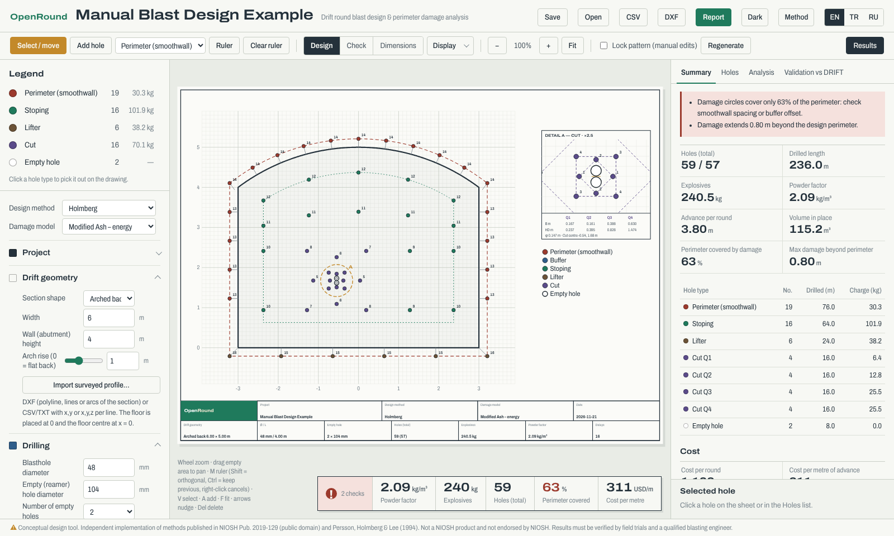
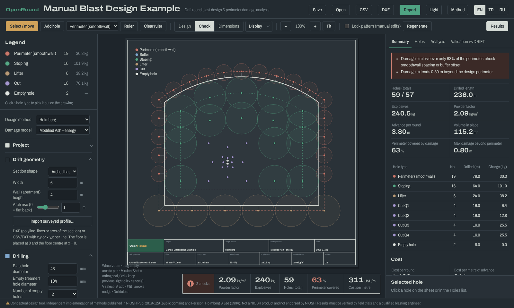
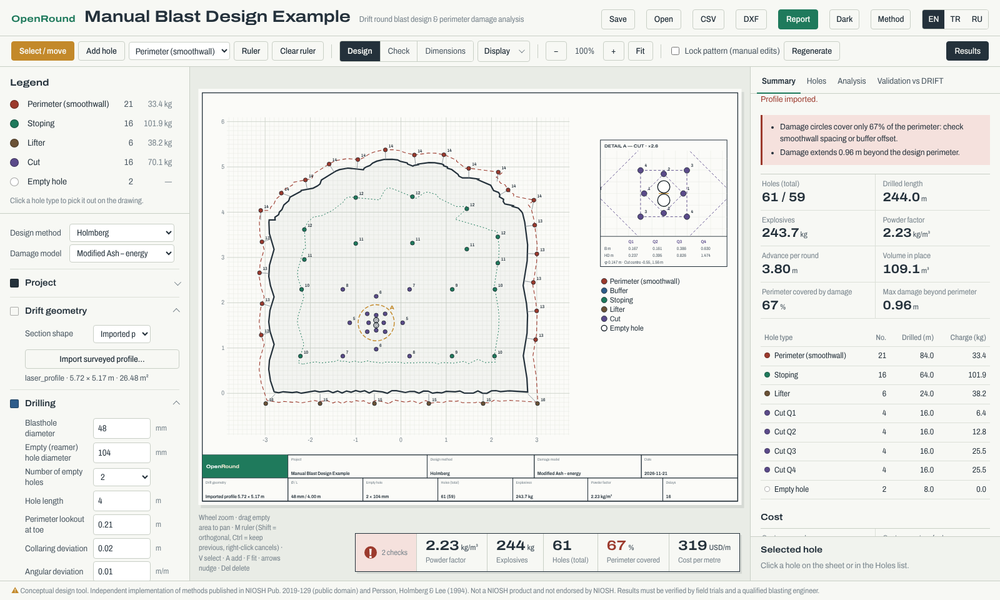

# OpenRound

**Drift round blast design and perimeter damage analysis — open source, runs in the browser or on Windows.**

OpenRound designs the blast round for an underground drift or tunnel face: cut, stoping, buffer, perimeter and lifter holes, charging, timing and costs. It then checks how far the blast damage reaches beyond the design perimeter. It reproduces the methods of the NIOSH **DRIFT 2.0** program (Pub. 2019-129, public domain). It adds a CAD-like drawing sheet, any section shape, import of surveyed profiles, and exports for mine-planning software.

**▶ Use it now: https://furkankasa.github.io/openround/** (nothing to install)
**⬇ Windows app:** [Releases](https://github.com/furkankasa/openround/releases)



## What it does

| | |
|---|---|
| **Design methods** | Holmberg (Persson, Holmberg & Lee), Buffer Row (NIOSH), Charge Region |
| **Damage models** | Modified Ash (energy, pressure), Langefors–Kihlström, Etkin, Holmberg–Persson (integral and sum), Johnson, Sher |
| **Section shapes** | Arched back, flat back, rounded rectangle, horseshoe, with sliders for arch rise, corner radius and wall radius. You can also **import a surveyed profile** from DXF, CSV or TXT: 2D or 3D polylines, mm or m. The section is projected and normalised automatically, and noisy laser scans are handled. |
| **Drawing sheet** | Zoom and pan, dimension chains, hole spacings, Detail A of the cut, title block, hover info for every hole, and a ruler that snaps to holes, collars, corners and the contour |
| **Checks** | Perimeter coverage by damage circles and damage depth beyond the design contour at any plane from collar to toe. Side-by-side comparison of all damage models. |
| **Outputs** | Hole list (CSV), drawing (DXF: 2D face plan and 3D hole traces), project file (JSON), PDF/HTML report, cost per round, per metre and per tonne |
| **Interface** | English, Türkçe, Русский · light and dark ("night shift") themes · works offline |



## Validated against DRIFT 2.0

The default project is the *Manual Blast Design Example* of DRIFT 2.0. The tests in `tests/` reproduce its report ([fixture](tests/fixtures/drift_manual_example_report.txt)) and run on every commit:

| Quantity | OpenRound | DRIFT 2.0 |
|---|---|---|
| Damage radius, smooth / buffer / full (m) | 0.3108 / 0.4403 / 0.6216 | 0.3108 / 0.4403 / 0.6216 |
| Maximum burden, smooth / buffer / full / lifter (m) | 0.9000 / 1.0947 / 1.2575 / 1.4060 | same |
| Cut Q1–Q4 hole distance (m) | 0.2365 / 0.3950 / 0.8257 / 1.4745 | 0.2365 / 0.3949 / 0.8255 / 1.4743 |
| Cut centre (m) | −0.54, 1.68 | −0.54, 1.67 |
| Back / ribs / lifters / Stope B / Stope C holes | 11 / 8 / 6 / 6 / 10 | 11 / 8 / 6 / 6 / 10 |
| Timing (holes per delay) | identical, 16 intervals | |

While reproducing the report we found three errors in DRIFT 2.0. Details are in [docs/validation.md](docs/validation.md).
1. **Face area:** the arch is counted twice. For a 6.0 × 5.0 m drift DRIFT reports 44.18 m², but the true area is 28.09 m². Volume and tonnage are therefore about 57 % too high, and the powder factor is too low (1.69 instead of 2.09 kg/m³).
2. **Stope C charge** is counted twice: DRIFT reports 304.19 kg, the true charge is 240.50 kg.
3. In the coupling-ratio table, the Johnson and Sher columns repeat the Holmberg–Persson column.

## Imported profiles



Click **Import surveyed profile…** and choose a DXF (LWPOLYLINE, POLYLINE, 3D POLYLINE, LINE/ARC chains or SPLINE) or a CSV/TXT file with `x,y` or `x,y,z` per line. If the file holds several closed shapes, you pick the right one. Sample files are in [`samples/`](samples/).

## Project layout

```
src/        engine.js (calculations and geometry), app.js (interface), i18n.js, defaults.js, index.template.html
lib/        clipper.min.js (polygon offsetting)
fonts/      Archivo (SIL OFL)
desktop/    Electron shell: native save dialogs, PDF reports
tests/      DRIFT validation and section-shape tests (node --test)
docs/       methods, validation, code signing
samples/    example DXF and CSV profiles
```

```bash
npm test          # engine tests
npm run build     # → dist/index.html (single file, works offline)
cd desktop && npm install && npm run dist:win   # Windows exe (portable and installer)
```

## Methods and references

The equations, assumptions and references are in [docs/methods.md](docs/methods.md). The main sources are:
- NIOSH [2019]. *A blast design technique to reduce risk of injury from ground falls (DRIFT)*. Kuchta M., Iverson S., Hustrulid W. DHHS (NIOSH) Pub. No. 2019-129.
- Persson P-A., Holmberg R., Lee J. [1994]. *Rock blasting and explosives engineering*. CRC Press.

## Disclaimer

OpenRound is a conceptual design tool. It is an independent implementation of published methods. It is **not a NIOSH product and is not endorsed by NIOSH**. Verify every design with field trials and a qualified blasting engineer, and follow your site's explosives regulations.

## License

[MIT](LICENSE). Bundled: Clipper (Boost licence), Archivo typeface (SIL OFL 1.1).

---

**Türkçe —** OpenRound, yeraltı galeri ve tünel aynaları için açık kaynaklı bir patlatma tasarımı ve kontur hasar analizi aracıdır. NIOSH DRIFT 2.0 ile doğrulanmıştır. Kemerli, düz tavanlı, köşesi yuvarlatılmış ve at nalı kesitler destekler, ölçülmüş kesitleri (DXF/CSV) de içe aktarır. Çıktıları CSV, DXF ve PDF rapordur. Tarayıcıda ya da Windows'ta çalışır.

**Русский —** OpenRound — открытая программа для проектирования взрывания забоя выработок и оценки зоны нарушения за контуром. Проверена по NIOSH DRIFT 2.0. Поддерживает сводчатые, прямоугольные, скруглённые и подковообразные сечения, а также импорт маркшейдерских профилей (DXF/CSV). Результаты выводятся в CSV, DXF и PDF-отчёт.
